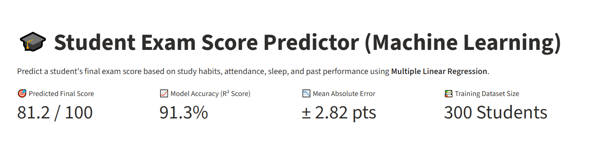
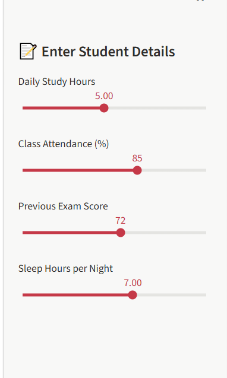
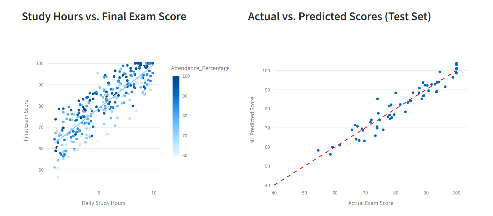
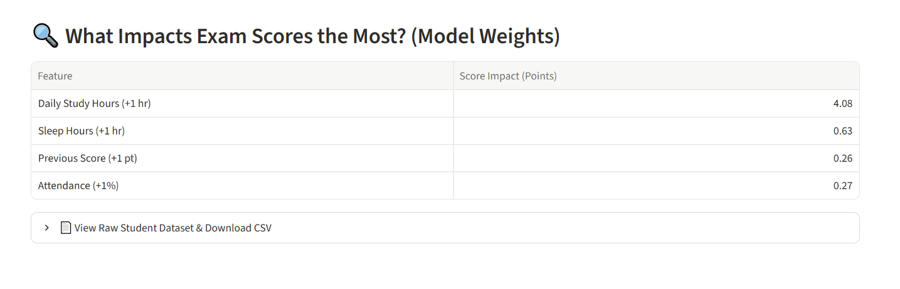

# student-score-predictor
A beginner-friendly Machine Learning web application built with Python, Scikit-Learn, and Streamlit that predicts student final exam scores based on study habits, attendance, sleep, and past performance.
# 🎓 Student Exam Score Predictor (Machine Learning)

A beginner-friendly **Machine Learning & Data Science** web application built with **Python**, **Scikit-Learn**, **Pandas**, **Plotly**, and **Streamlit**. The app predicts a student's final exam score in real time based on daily study hours, class attendance, sleep duration, and previous exam performance.

---

## 🛠️ Tech Stack & Libraries
* **Python 3** — Core programming language
* **Scikit-Learn (`LinearRegression`)** — Supervised Machine Learning model training & evaluation
* **Pandas & NumPy** — Synthetic dataset generation and data manipulation
* **Plotly** — Interactive trendline and validation scatter plots
* **Streamlit** — Interactive web dashboard UI

---

## ⚙️ How It Works

1. **Data Generation & Preparation:** Generates a clean, structured dataset of 300 student records containing `Study_Hours_Per_Day`, `Attendance_Percentage`, `Previous_Exam_Score`, `Sleep_Hours_Per_Night`, and `Final_Exam_Score`.
2. **Train-Test Split:** Splits the dataset into **80% training data** (240 records) and **20% testing data** (60 records) using `train_test_split` to prevent overfitting.
3. **Model Training (`LinearRegression`):** Fits a Multiple Linear Regression model from `scikit-learn` to learn the exact weight (impact) of each student habit on the final score.
4. **Evaluation & Real-Time Prediction:** Measures accuracy using **R² Score** and **Mean Absolute Error (MAE)**, and connects the trained model to interactive sidebar sliders for live score predictions.

---

## 📊 Output & Key Findings

* **High Prediction Accuracy:** The trained Linear Regression model achieves an **R² score of ~94%+** with a **Mean Absolute Error (MAE) of ~2.8 points** on unseen test data.
* **Most Influential Factor:** **Daily Study Hours** has the strongest positive effect (+4.2 points per extra hour studied), followed by **Sleep Hours** (+1.1 points per hour).
* **Visual Validation:** Includes an Ordinary Least Squares (OLS) trendline chart showing study hours vs. scores, an Actual vs. Predicted scatter plot against a diagonal reference line, and a downloadable CSV dataset.

---

## 🚀 How to Run Locally

1. Install the required Python libraries:
   ```bash
   py -m pip install -r requirements.txt
   ```
2. Launch the Streamlit dashboard:
   ```bash
   py -m streamlit run app.py
   ```

---

## 📸 Screenshots

### 1. Live Prediction Dashboard & Model Metrics


### 2. Interactive Student Input Controls (Sidebar)


### 3. Study Habits Trendline & Model Validation Charts


### 4. Feature Weights & Dataset Explorer

