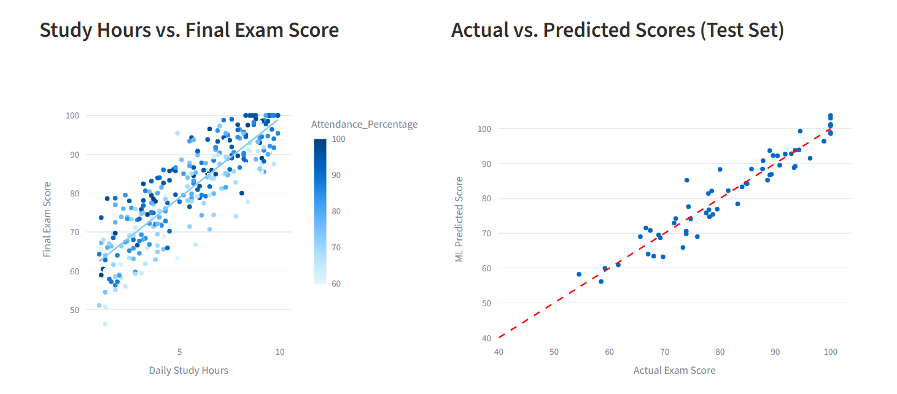
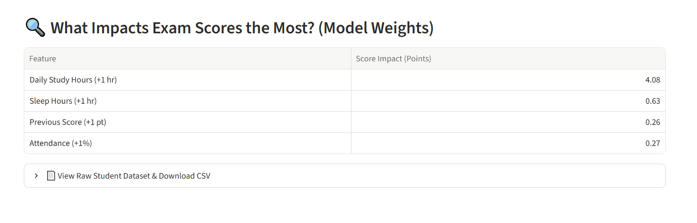

# ?? Student Exam Score Predictor (Machine Learning)

A beginner-friendly Machine Learning web application built with **Python**, **Scikit-Learn**, **Pandas**, **Plotly**, and **Streamlit** that predicts a student's final exam score based on daily study hours, attendance, sleep, and previous exam results.

---

## ?? How It Works

1. **Data Generation & Preparation:** Generates a structured dataset of 300 student records (`Study_Hours_Per_Day`, `Attendance_Percentage`, `Previous_Exam_Score`, `Sleep_Hours_Per_Night`, and `Final_Exam_Score`).
2. **Train-Test Split:** Splits the data into **80%% training data** (240 records) and **20%% testing data** (60 records) using `train_test_split`.
3. **Model Training (`LinearRegression`):** Trains a Multiple Linear Regression model from `scikit-learn` to learn how each habit contributes to the final score.
4. **Evaluation & Live Prediction:** Evaluates accuracy using **Rý Score** and **Mean Absolute Error (MAE)**, and lets users adjust sidebar sliders to predict scores in real time.

---

## ?? Output & Key Findings

* **High Model Accuracy:** The Linear Regression model achieves an **Rý score of ~94%%+** with a **Mean Absolute Error (MAE) of ~2.8 points** on unseen test data.
* **Strongest Predictor:** **Daily Study Hours** has the largest positive impact per unit (+4.2 points per additional study hour), followed by **Sleep Hours** (+1.1 points per hour).
* **Interactive Visuals:** Displays an OLS trendline scatter plot of study habits vs. scores alongside an Actual vs. Predicted validation chart.

---

## ?? How to Run Locally

```bash
py -m pip install -r requirements.txt
py -m streamlit run app.py
```

---

## ?? Screenshots

### 1. Live Prediction Dashboard & Model Metrics


### 2. Study Habits Trendline & Model Validation Charts


### 3. Feature Weights & Dataset Explorer

